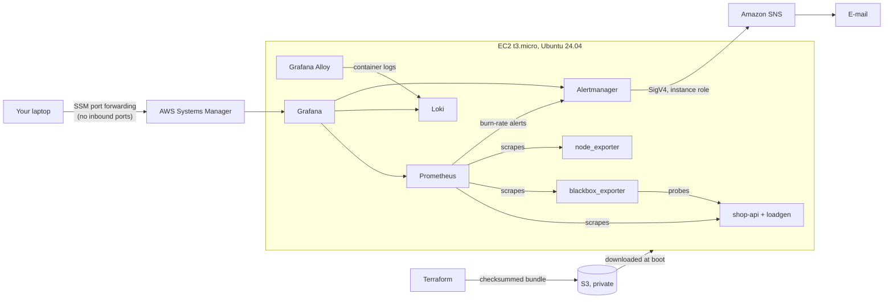

# SLO Cockpit

**SLO-as-code on a single server.** Service level objectives are written in YAML and compiled
into Prometheus recording rules and **multi-window, multi-burn-rate alerts** (Google SRE Workbook,
ch. 5), with a live error-budget dashboard, e-mail paging through Amazon SNS, and a fault
injector that burns error budget on demand. One `terraform apply` builds everything in about
5 minutes; `terraform destroy` removes it.

> Demo video: *(add your recording here)*

## What it demonstrates

| Concept | Where |
|---|---|
| SLI / SLO / error budget | [`slos/slos.yaml`](slos/slos.yaml) and the *SLO Cockpit* dashboard |
| Burn-rate vs. threshold alerting | [`tools/slo_generator.py`](tools/slo_generator.py): 1h/5m + 6h/30m pages, 1d/2h + 3d/6h tickets |
| Alert fatigue | pages only for SLO burn; causes open tickets; page inhibits ticket; silences for drills |
| Alerts are tested code | promtool unit tests, generated per SLO ([`tests/`](tests/)) |
| Pull-based metrics, RED method | Prometheus scrapes a Flask app instrumented with rate/errors/duration |
| Black-box vs. white-box monitoring | blackbox_exporter probes vs. the app's own metrics |
| Cardinality | route templates as labels, dropped histogram series, dropped log labels |
| Log aggregation | JSON logs -> Grafana Alloy -> Loki, correlated on the same dashboards |
| Infrastructure as code | Terraform, including tests against a mocked AWS provider |
| Configuration management | Ansible roles run by the server itself at boot |
| Immutable bootstrap | every change ships a new checksummed bundle and a brand-new server |
| Containerisation | 9 hardened containers with memory limits on 1 GB of RAM |

## Architecture



## SLOs and alerting policy

`python tools/slo_generator.py` prints the policy it generated:

```
checkout-availability: objective 99.5%  ->  error budget 0.5% = 216 bad minutes per 30d
    page   when the error ratio is > 7.2% (1h and 5m) or > 3% (6h and 30m)
    ticket when the error ratio is > 1.5% (1d and 2h) or > 0.5% (3d and 6h)
api-latency: objective 99%  ->  error budget 1% = 432 bad minutes per 30d
synthetic-availability: objective 99.9%  ->  error budget 0.1% = 43.2 bad minutes per 30d
```

The long window proves the burn is significant; the short window proves it is still happening,
so the alert also resolves quickly once the problem is fixed.

## Security design

- **No inbound ports at all.** The security group has zero ingress rules; access is through
  SSM Session Manager port forwarding, authorised by IAM. No SSH keys exist.
- **No long-lived credentials.** You use `aws login` (short-lived console credentials); the
  server uses its instance role; Alertmanager signs SNS calls with it (SigV4).
- **IMDSv2 only**, and a host firewall rule lets *only* Alertmanager's container reach the
  metadata service, so a compromised container cannot steal the server's AWS credentials.
- **Secrets never touch Terraform state or user data**: ephemeral random values with write-only
  arguments go straight into SSM Parameter Store (SecureString); the server reads them at deploy
  time into files readable only by the one container user that needs each.
- **Least-privilege IAM**: one S3 prefix, two parameters, one SNS topic.
- **Checksummed deploys**: the server refuses a bundle whose SHA-256 differs from the planned one.
- **Hardened containers**: read-only filesystems, all Linux capabilities dropped, no privilege
  escalation, non-root users, memory/PID limits, ports bound to 127.0.0.1 only, no Docker socket
  mounted anywhere (Alloy reads log files read-only instead).
- Encrypted disk, encrypted private S3 bucket that refuses non-TLS requests, encrypted SNS topic,
  pinned versions everywhere, Dependabot, CI with least-privilege token.

## Run it

- **On your laptop (free):** `python scripts/local_setup.py`, then in `stack/compose`:
  `docker compose up -d --build --wait` and open http://localhost:3000/d/slo-cockpit
- **On AWS:** fill in `terraform/terraform.tfvars`, then in `terraform/`: `terraform init` and
  `terraform apply`. Then `python scripts/tunnel.py` and open http://localhost:3000/d/slo-cockpit
- **Burn some budget:** `python scripts/chaos.py outage --minutes 10` (add `--local` on your laptop)
- **Tear down:** `terraform destroy`


## Cost

Not Always-Free: t3.micro + 20 GB gp3 + a public IPv4 address cost about **$0.42/day
(~$12.80/month) in us-east-1** while running. Destroy it between demos; a new-account
credit balance covers weeks of demos.

## Tests

| What | Command |
|---|---|
| Alert + SLI unit tests | `docker run --rm -v "${PWD}:/work" -w /work --entrypoint promtool quay.io/prometheus/prometheus:v3.15.0 test rules tests/slo-alerts.test.yml tests/sli-recording.test.yml` |
| Terraform (mock AWS) | `cd terraform; terraform init -backend=false; terraform test` |
| Generated files current | `python tools/slo_generator.py --check` and `python tools/dashboards.py --check` |

All of them run in GitHub Actions on every push ([`.github/workflows/validate.yml`](.github/workflows/validate.yml)).

## Design decisions

- **Ansible runs on the server itself** (pull model, like `ansible-pull`) instead of over SSH, so no
  inbound access or SSH keys are needed and one `terraform apply` does everything.
- **Immutable servers:** a changed bundle replaces the instance rather than patching it in place.
- **Error budget in "bad minutes":** the budget panel integrates the 5-minute error ratio over time,
  so a young stack shows sensible numbers (a 10-minute outage = 10 bad minutes) instead of treating
  its first hour as the whole month.
- **Grafana Alloy instead of Promtail:** Promtail reached end-of-life in March 2026.
